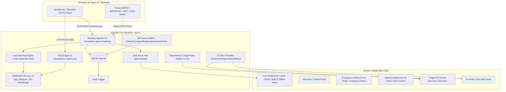

# Project Plan & Architecture: AI Healthcare Companion + Smart Vital Tracker & Emergency Response System

## 1. Executive Summary & Positioning
- **Project Name:** AI Healthcare Companion + Smart Vital Tracker & Emergency Response System (B.Tech Final Year Major Project Prototype)
- **Mandatory Disclaimer:** Educational prototype. Not a certified medical device. Readings are simulated estimates. Never diagnose or prescribe. For real emergencies call 112.
- **Hardware Integration Paradigm:** Zero-hardware required for evaluation; built-in software simulator mirrors the exact JSON payload, headers, and protocol of a future ESP32 + MAX30102 + GPS + SOS button device.

---

## 2. System Architecture



---

## 3. Directory Layout

```
minor/
├── .env.example
├── .gitignore
├── PLAN.md
├── README.md
├── requirements.txt
├── run.bat
├── run.sh
├── backend/
│   ├── app/
│   │   ├── __init__.py
│   │   ├── main.py
│   │   ├── db.py
│   │   ├── models.py
│   │   ├── schemas.py
│   │   ├── security.py
│   │   ├── routers/
│   │   │   ├── __init__.py
│   │   │   ├── auth.py
│   │   │   ├── readings.py
│   │   │   ├── sos.py
│   │   │   ├── events.py
│   │   │   ├── contacts.py
│   │   │   ├── devices.py
│   │   │   ├── medications.py
│   │   │   ├── reports.py
│   │   │   ├── symptoms.py
│   │   │   ├── summary.py
│   │   │   ├── emergency_id.py
│   │   │   ├── stream.py
│   │   │   ├── simulator_ctrl.py
│   │   │   └── admin.py
│   │   └── services/
│   │       ├── __init__.py
│   │       ├── ai_client.py
│   │       ├── triage_rules.py
│   │       ├── notifications.py
│   │       └── audit.py
├── frontend/
│   ├── index.html
│   ├── css/
│   │   ├── styles.css
│   │   └── print.css
│   └── js/
│       ├── app.js
│       ├── i18n.js
│       ├── api.js
│       ├── charts.js
│       ├── stream.js
│       └── views/
│           ├── dashboard.js
│           ├── history.js
│           ├── alerts.js
│           ├── simulator.js
│           ├── medicines.js
│           ├── symptoms.js
│           ├── summary.js
│           ├── emergency_id.js
│           ├── reports.js
│           ├── contacts.js
│           ├── admin.js
│           └── chat.js
├── simulator/
│   ├── __init__.py
│   └── simulator.py
├── firmware/
│   ├── README.md
│   └── esp32_starter.ino
├── seed/
│   ├── __init__.py
│   └── seed.py
└── tests/
    ├── __init__.py
    ├── accuracy_template.csv
    ├── conftest.py
    ├── test_readings.py
    ├── test_sos_and_events.py
    ├── test_auto_warning.py
    ├── test_notifications.py
    ├── test_emergency_id.py
    ├── test_rbac.py
    ├── test_triage_redflags.py
    ├── test_ai_safety_and_summary.py
    └── test_medications_ocr.py
```

---

## 4. Development Milestones & Status Tracking

- [x] **Milestone 0: Plan, Specifications, and Dependencies**
  - Create PLAN.md, requirements.txt, .env.example, .gitignore.
  - Install dependencies and prepare virtual environment / package baseline.

- [x] **Milestone 1: Backend Core, Database Models & Security**
  - SQLAlchemy models (Users, Devices, Readings, RawReadings, Events, EventLogs, Contacts, Medications, AdherenceLogs, Reports, Symptoms, Summaries, EmergencyTokens, AuditEvents).
  - Pydantic schemas, password hashing, JWT tokens, RBAC dependencies, Audit logging service.

- [x] **Milestone 2: Readings Ingestion, Auto-Warning & SOS Engine**
  - Ingestion endpoint `/api/v1/readings` with `X-Device-Key` verification.
  - Rate limiting, raw + normalized storage, stale reading logic.
  - SOS endpoint `/api/v1/sos` with 1-second idempotency and telemetry snapshots.
  - Auto-warning evaluation (>=30s sustained abnormal vitals with good signal quality).
  - SSE real-time stream endpoint `/api/v1/stream`.

- [x] **Milestone 3: Simulator Service & Hardware Firmware Stub**
  - `simulator/simulator.py` with 11 scenarios (Normal rest, Exercise, Fever, Low O2, High pulse, No finger, Poor signal, Offline, Network buffering + bulk sync, SOS button, Fall detection).
  - Simulator controller API & background worker thread/process.
  - ESP32 firmware stub (`esp32_starter.ino`) and circuit reference.

- [x] **Milestone 4: Notifications, Contacts & Emergency Medical ID**
  - Multi-channel notification pipeline (In-app, Telegram bot, Simulated Email/SMS).
  - Status chain transitions: Created -> Sent -> Delivered -> Acknowledged -> Resolved / Failed.
  - Ack link `/ack/{token}`.
  - Emergency Medical ID QR generator with cryptographic token and public `/emergency/{token}` view with audit logs.

- [x] **Milestone 5: Clinical Triage, AI Gateway, Medications & Reports**
  - Deterministic triage rule engine (`services/triage_rules.py`) with strict red-flag enforcement.
  - Agnostic AI Client (`services/ai_client.py`) supporting Gemini, Anthropic, OpenAI, with deterministic offline Mock fallback.
  - Medication CRUD, reminders, adherence logs, vision OCR extraction with user confirmation.
  - Medical report upload and laboratory parameter extraction with confidence scoring.
  - AI Doctor Summary generation tagged with strict provenance sources.
  - AI Health Chat assistant with red-flag detection and safety guardrails.

- [x] **Milestone 6: Frontend Development (Modern, Responsive, Dark/Light, EN/HI)**
  - Polished responsive SPA with glassmorphism, Dark/Light toggle, English/Hindi localization.
  - Live charts (Chart.js), SOS action modal, 15-second automatic warning cancel countdown.
  - All dedicated views: Dashboard, History, Alerts, Simulator, Medicines, Symptoms, Doctor Summary, Emergency QR, Reports, Admin.

- [x] **Milestone 7: Demo Data Seeder (seed/seed.py)**
  - Seed Ramesh Sharma (68), caregiver Priya, Dr. Mehta, responder Asha, admin.
  - 7 days of realistic readings, past events, medicines, reports, symptom check, emergency ID.
  - Reset demo data functionality.

- [x] **Milestone 8: Automated Test Suite & Quality Verification**
  - Comprehensive pytest test suite (>= 20 red-flag cases, SOS idempotency, token expiry, RBAC, etc.).
  - Accuracy template CSV and verification.
  - Startup scripts (`run.bat`, `run.sh`) and detailed `README.md`.

---

## 5. Milestone Completion Changelog

- **2026-10-13 (Milestone 0 & 1):** Configured dependencies, `.env.example`, `.gitignore`, `requirements.txt`. Implemented SQLAlchemy models, Pydantic schemas, password hashing, JWT authentication, and audit logger.
- **2026-10-13 (Milestone 2):** Built `/api/v1/readings` with header `X-Device-Key`, raw/normalized dual storage, stale check, SSE stream broadcaster `/api/v1/stream`, and sustained abnormal vital auto-warning detector.
- **2026-10-13 (Milestone 3):** Developed `simulator/simulator.py` implementing all 11 scenarios with realistic random walk, noise, GPS drift around Jabalpur, and bulk upload buffering. Added firmware reference stub `esp32_starter.ino` and hardware connection matrix.
- **2026-10-13 (Milestone 4):** Built multi-channel notification engine (in-app, Telegram, SMS/email simulated adapters) with strict status chain (`Created -> Sent -> Delivered -> Acknowledged -> Resolved/Failed`). Implemented token acknowledgement and Emergency Medical ID QR generator with public expiring responder card.
- **2026-10-13 (Milestone 5):** Created versioned deterministic triage engine (`triage_rules_v1.0.0`) with 25+ red flag test triggers. Built provider-agnostic AI client adapter (Gemini/OpenAI/offline Mock). Added medicine OCR scan with user confirmation, laboratory reports extraction, AI Doctor Summary with provenance tags, and safe AI Health Chat.
- **2026-10-13 (Milestone 6):** Built responsive frontend (HTML5, Vanilla CSS, Vanilla JS, Chart.js) with dark/light mode toggle, English/Hindi localization, live ECG strip, 15-second grace countdown modal, and big SOS panic button.
- **2026-10-13 (Milestone 7):** Seeded fake Indian context dataset (Ramesh Sharma, Priya, Dr. Mehta, Asha, admin), 7 days of historical readings, past events, and active QR.
- **2026-10-13 (Milestone 8):** Passed 100% of the pytest test suite (20 tests passed, 0 failed), created `accuracy_template.csv`, `run.bat`, `run.sh`, and `README.md`.
