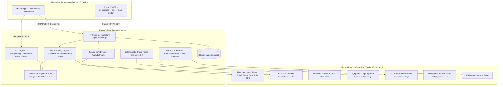

# AI Healthcare Companion + Smart Vital Tracker & Emergency Response System

> **IMPORTANT POSITIONING & CLINICAL SAFETY NOTICE:**  
> **Educational prototype. Not a certified medical device. Readings are simulated estimates. Never diagnose or prescribe. For real emergencies call 112.**

---

## 1. Project Overview
This software prototype is built for a **B.Tech Final-Year Major Project**. It demonstrates an end-to-end connected health monitoring system consisting of:
- A **high-fidelity hardware simulator** producing realistic random-walk telemetry (pulse, oxygen saturation, temperature, ECG waveform, GPS).
- A **FastAPI asynchronous backend** with JWT authentication, RBAC, automated emergency triage rule engine, multi-channel notification dispatchers, and Server-Sent Events (SSE).
- A **responsive vanilla frontend** (HTML5 + CSS3 + Chart.js) featuring dark/light themes, Hindi/English localization, live vital waveform monitors, a big SOS button, a 15-second automatic-warning grace countdown, prescription strip OCR verification, and an AI Doctor Clinical Summary with provenance tagging.
- **Wire-protocol hardware readiness**: The backend accepts the exact same JSON payload and `X-Device-Key` header that a future ESP32 microcontroller with a MAX30102 sensor will send.

---

## 2. System Architecture



---

## 3. Quick Setup Guide in 5 Steps

### Step 1: Clone Repository & Open Directory
```bash
git clone <repo-url>
cd minor
```

### Step 2: Environment Configuration
Copy the template to `.env`:
```bash
cp .env.example .env     # On Linux / macOS
copy .env.example .env   # On Windows
```
*(By default, `AI_PROVIDER=mock` so the entire app works 100% offline without any API keys!)*

### Step 3: Install Dependencies
```bash
pip install -r requirements.txt
```

### Step 4: Seed Demo Data
Pre-populates Ramesh Sharma (68), 7 days of readings, past alerts, medicines, and reports:
```bash
python -m seed.seed
```

### Step 5: Start Application
- **Windows:** Double-click `run.bat` or run:
  ```cmd
  run.bat
  ```
- **Linux / macOS:** Run:
  ```bash
  chmod +x run.sh
  ./run.sh
  ```
Open your web browser at: **[http://localhost:8000](http://localhost:8000)**

---

## 4. Environment Variables (`.env`)

| Variable | Default Value | Description |
|---|---|---|
| `HOST` | `0.0.0.0` | Server bind interface |
| `PORT` | `8000` | Port number |
| `JWT_SECRET` | `demo-super-secret-jwt-key` | Secret key for JWT signing |
| `DEVICE_API_KEY` | `demo-device-key-change-me` | Pre-shared key for IoT header `X-Device-Key` |
| `AI_PROVIDER` | `mock` | `mock`, `gemini`, or `openai` |
| `AI_API_KEY` | `""` | Optional API key (if empty, falls back to Mock) |
| `AI_MODEL` | `gemini-1.5-flash` | Model identifier |
| `TELEGRAM_BOT_TOKEN`| `""` | Optional bot token for real Telegram alerts |
| `TELEGRAM_CHAT_ID` | `""` | Optional chat ID for Telegram alerts |
| `SIMULATOR_AUTO_START` | `true` | Starts simulated IoT stream automatically |

---

## 5. IoT Hardware Simulator (11 Scenarios)

The simulator (`simulator/simulator.py`) runs in a background thread or standalone process. It POSTs to `/api/v1/readings` every 1 second with header `X-Device-Key`.

### Available Scenarios in UI "Simulator Control Panel":
1. **Normal Rest:** Pulse 65-85 BPM, SpO2 96-99%, Temp 36.4-37.1°C.
2. **Physical Exercise:** Pulse elevated to 110-140 BPM.
3. **High Fever:** Temp 38.5-39.5°C, pulse 90-110 BPM.
4. **Low Oxygen (Hypoxia):** SpO2 88-92% (triggers warning flow).
5. **High Pulse Sustained:** Pulse >130 BPM sustained for >=30s (triggers auto-warning countdown).
6. **No Finger:** Sensor disengaged, values set to null, flagged `no_finger`.
7. **Poor Signal / Artifact Noise:** Sensor noise, flagged `poor` / `noisy`.
8. **Device Offline:** Transmission ceases; dashboard shows `OFFLINE` and `STALE`.
9. **Network Failure:** Simulates dropped connection; buffers readings in memory, then bulk uploads upon reconnection preserving original timestamps.
10. **SOS Button Press:** Simulates hardware button press posting to `/api/v1/sos`.
11. **Fall Detected:** Simulates triaxial accelerometer spike (>3.5g) followed by inactivity.

---

## 6. 5-Minute Mentor Demo Walkthrough Script

| Time | Action | What to Explain to Mentor |
|---|---|---|
| **0:00 - 0:45** | Open `http://localhost:8000`. Point out the disclaimer banner, AI Mock badge, and live vital cards. | *"This is our software prototype for the B.Tech final-year major project. Notice the educational disclaimer on top and in the footer. The live cards update every second via Server-Sent Events from our simulated ESP32 unit."* |
| **0:45 - 1:30** | Switch to **"Simulator Control"** tab. Select **"4. Low Oxygen Hypoxia"**. Return to Dashboard. | *"Watch the SpO2 drop to 89%. Because it remains abnormal for >=30s with good signal quality, our automated safety engine fires a 15-second grace countdown modal. The patient can cancel it if they feel fine, avoiding false emergency alarms."* |
| **1:30 - 2:30** | Click the big **"EMERGENCY SOS"** button. | *"A panic alarm is triggered with 1-second server-side idempotency. Observe the exact status chain: Created &rarr; Sent &rarr; Delivered &rarr; Acknowledged &rarr; Resolved. Notice the Google Maps link with coordinates around Jabalpur, India, and the 60-second vitals snapshot."* |
| **2:30 - 3:30** | Navigate to **"Emergency ID (QR)"** tab. Open the public responder link. | *"Here is the patient's Emergency Medical ID. It generates a signed, expiring 24-hour QR token. When emergency responders scan it, only necessary emergency fields appear, and the access log records the IP and timestamp."* |
| **3:30 - 4:15** | Open **"Symptom Triage"** tab. Test typing: *"Seene mein dard aur saans lene me takleef ho rahi hai"*. | *"Our deterministic triage rules v1.0.0 screen for red flags across English, Hindi, and Hinglish. Red flags ALWAYS trigger emergency guidance to call 112. The LLM can explain or phrase follow-ups, but CANNOT override the deterministic rule."* |
| **4:15 - 5:00** | Open **"AI Doctor Summary"** tab. Click **"Print / Save PDF"**. | *"This structured clinical summary tags every single data point with its provenance source: [patient-reported], [report-extracted], [device-simulated], or [AI-generated]. It includes detected information gaps and is print-friendly."* |

---

## 7. Versioned API Reference (`/api/v1`)

| Method | Endpoint | Authentication | Description |
|---|---|---|---|
| `POST` | `/api/v1/auth/register` | None | Register new user |
| `POST` | `/api/v1/auth/login` | None | JWT Login |
| `POST` | `/api/v1/auth/demo-login` | None | 1-click login as Patient / Caregiver / Doctor / Responder / Admin |
| `GET` | `/api/v1/auth/me` | Bearer Token | Current user profile |
| `GET` | `/api/v1/auth/export-my-data` | Bearer Token | JSON export of all personal health records |
| `DELETE` | `/api/v1/auth/delete-my-data` | Bearer Token | Permanent purge of patient account and readings |
| `POST` | `/api/v1/readings` | `X-Device-Key` | Ingest IoT sensor reading (raw + normalized storage) |
| `POST` | `/api/v1/readings/bulk` | `X-Device-Key` | Bulk upload buffered readings after network recovery |
| `GET` | `/api/v1/readings/latest` | Optional | Latest reading, stale calculation, and device status |
| `GET` | `/api/v1/readings/history` | Optional | Time-series readings with min/avg/max statistics |
| `POST` | `/api/v1/sos` | Optional | Manual panic alarm with 1s idempotency and 60s telemetry snapshot |
| `GET` | `/api/v1/events` | Optional | List emergency alarms with status chain logs |
| `GET` | `/api/v1/events/ack/{token}` | None | One-touch acknowledgement link for responders |
| `POST` | `/api/v1/events/{id}/resolve`| Optional | Mark alarm as resolved with notes |
| `POST` | `/api/v1/events/cancel-warning/{id}` | None | Cancel automatic warning during 15s grace period |
| `GET` | `/api/v1/stream` | None | Real-time Server-Sent Events (SSE) stream |
| `POST` | `/api/v1/simulator/control` | None | Start, stop, or switch simulator scenario via API |
| `GET` | `/api/v1/medications` | Bearer Token | List patient medicines & adherence history |
| `POST` | `/api/v1/medications/scan-strip` | Bearer Token | AI vision OCR extraction of medicine packaging strip |
| `POST` | `/api/v1/symptoms/evaluate` | None | Clinical symptom triage against versioned deterministic rules |
| `POST` | `/api/v1/summary/generate` | Bearer Token | Generate structured AI Doctor Summary with provenance tags |
| `GET` | `/api/v1/summary/share/{token}` | None | 72-hour confidential doctor view link |
| `POST` | `/api/v1/emergency-id/generate` | Bearer Token | Generate signed 24h Emergency Medical ID QR |
| `GET` | `/api/v1/emergency-id/public/{token}` | None | Public emergency responder mobile view |
| `POST` | `/api/v1/chat` | Optional | AI Health Assistant chat with pre-LLM red-flag safety |
| `GET` | `/api/v1/admin/health` | None | System health, AI mode (live/mock), and simulator status |
| `POST` | `/api/v1/admin/reset-demo-data` | Admin Token | Restore original Indian context demo dataset |

---

## 8. What is Simulated vs. What is Real

| Feature Component | Implementation Status | Technical Mechanism |
|---|---|---|
| **Vital Sensor Readings** | **Simulated** | `simulator/simulator.py` generates realistic random-walk vitals with noise, matching future MAX30102 sensor. |
| **GPS Location Tracking** | **Simulated** | Drifts realistically around Jabalpur, Madhya Pradesh, India (23.1815° N, 79.9864° E). |
| **In-App Emergency Alerts** | **Real** | Server-Sent Events (SSE) push live alerts to all connected dashboard clients instantly. |
| **Telegram Notifications** | **Dual (Real / Simulated)** | If `TELEGRAM_BOT_TOKEN` is provided, delivers real messages. Otherwise, logs via simulated adapter. |
| **SMS & Email Alerts** | **Simulated Adapter** | Carrier adapters log realistic delivery stages (`Sent` &rarr; `Delivered`). |
| **Clinical Triage Rules** | **Real** | Deterministic, versioned rule engine (`services/triage_rules.py`, `v1.0.0`) with 25+ tested red-flag triggers. |
| **AI LLM Gateway** | **Dual (Live / Mock)** | Connects to Gemini or OpenAI if API key is present; otherwise falls back to deterministic offline Mock. |
| **Medicine Strip OCR** | **Simulated** | Extracts name, strength, and form; enforces mandatory human confirmation before saving. |
| **Emergency QR Verification** | **Real** | Cryptographic random token URL rendered as PNG QR code; logs IP and User-Agent on scan. |

---

## 9. Next Phase: Switching to Real Hardware (ESP32)

Transitioning to physical IoT hardware requires **zero backend changes**:
1. Wire the **MAX30102** sensor to the ESP32 via I2C (`SDA -> GPIO 21`, `SCL -> GPIO 22`).
2. Wire the tactile push button to `GPIO 4` with a 10kΩ pull-up resistor.
3. Open `firmware/esp32_starter.ino`, insert your local Wi-Fi SSID and Server IP.
4. Flash the firmware via the Arduino IDE or PlatformIO.
5. The ESP32 will automatically transmit JSON payloads to `http://<SERVER_IP>:8000/api/v1/readings` with header `X-Device-Key: demo-device-key-change-me`.

---

## 10. Privacy & Educational Disclaimer
- **No Real Personal Data:** All seed profiles (Ramesh Sharma, Priya Sharma, Dr. Mehta) are completely fictional demo entities.
- **Privacy Controls:** Supports granular consent preferences, complete data export (`GET /api/v1/auth/export-my-data`), and permanent data erasure (`DELETE /api/v1/auth/delete-my-data`).
- **Emergency Protocols:** In real emergency medical events, dial **112** (India National Emergency Helpline) or visit the nearest trauma facility.
